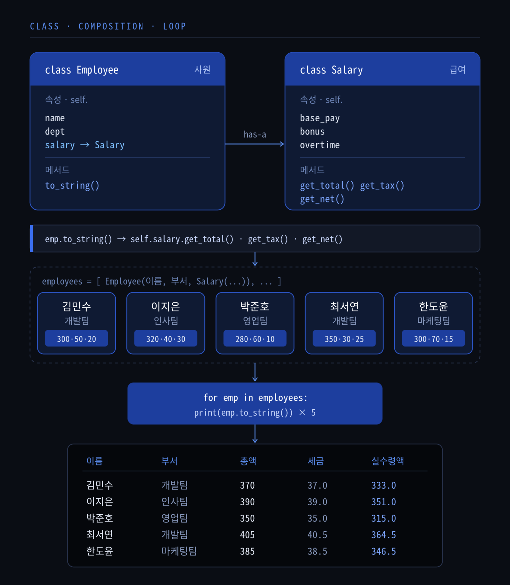
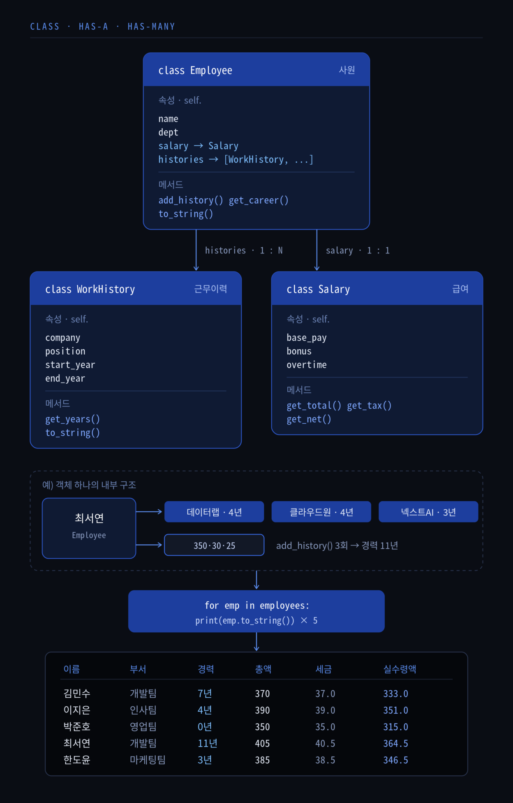

# Class_Method

Python 클래스와 객체, 생성자·소멸자, 접근 제어, 상속을 학습하고 객체 간 협력 구조까지 확장해 본 실습 기록입니다. Jupyter Notebook에서 개념과 문제를 익히고, Python 스크립트로 성적표와 회사 관리 예제를 단계적으로 구현했습니다.

## 무엇을 배웠나요?

| 학습 주제 | 학습 내용 | 실습 방식 |
| --- | --- | --- |
| 클래스와 객체 | 클래스와 인스턴스의 차이, 속성, 인스턴스 메서드, `self` | `Dog`, `Student`, `BankAccount`, `ChatBot`을 만들고 객체별 상태 확인 |
| 초기화와 객체 수명 | `__init__`, 기본값·키워드 인자, `__del__`, 참조 관계 | 생성·재할당·참조 삭제 시 메시지를 관찰하고 연결 객체 구현 |
| 접근 제어와 캡슐화 | public, `_name` 관례, `__name` 이름 맹글링, getter/setter, `@property` | 잔액·점수·대화 기록을 다루는 예제와 빈칸 문제로 학습 |
| 상속과 기능 확장 | 부모·자식 클래스, 오버라이딩, `super()`, 타입 관계와 MRO | 동물·교통수단 예제에서 시작해 공통 API 클라이언트와 특화 챗봇 구현 |
| 상태 관리와 자원 정리 | 클래스 변수와 인스턴스 변수, 가변 리스트 공유, 파일 닫기 | 챗봇 기록 분리, 접속자 수 집계, `FileLogger`와 `with` 문 구현 |
| 객체 간 협력 | 객체를 속성으로 보유하는 has-a 관계, 객체 리스트, 책임 분리 | `Employee` → `Department` → `Company` 구조로 급여와 경력 집계 |

`_name`은 접근을 강제로 막는 기능이 아니라 내부용이라는 관례입니다. `__name` 역시 보안 장치가 아니라 이름 충돌과 실수 방지를 위한 이름 맹글링입니다. `del`은 참조를 제거하며, `__del__`의 실행 시점은 항상 보장되지 않으므로 파일 같은 자원은 `close()`나 `with`로 명시적으로 정리하는 것이 핵심입니다.

## 어떻게 실습했나요?

### 1. 개념을 읽고 직접 객체 만들기

[클래스·객체 실습](1-1_class_object_실습.ipynb)에서 빈칸을 채우고 메서드를 호출하면서 `self`와 객체별 속성 변화를 확인했습니다. 학생의 합격 여부, 계좌 입출금, 챗봇 대화 기록처럼 작은 기능을 클래스로 묶었습니다.

### 2. 생성과 정리 과정 관찰하기

[생성자·소멸자 실습](2-1_생성자소멸자_실습.ipynb)에서 초기값 설정, 음수 입력 보정, 객체 재할당과 참조 삭제를 다뤘습니다. 정삼각형 `Figure`, 모의 `ApiClient`, 챗봇 예제로 객체 수명과 상태를 연습했습니다. API 예제는 실제 외부 서비스 호출이 아닌 학습용 모의 구현입니다.

### 3. 접근 제어와 복습 문제 풀기

[접근 제어 실습](3_접근제어_실습.ipynb)은 public/protected/private 표기, 상속 맛보기, 이름 맹글링, getter/setter와 `@property`를 다룹니다. 일부 셀은 빈칸·골격 상태로 남아 있습니다.

| 복습 파일 | 문제 구성 | 확인 방법 |
| --- | --- | --- |
| [클래스·객체 복습](1-2_class_object_복습테스트.ipynb) | `Product`, `PointCard`, `TodoList`, 챗봇 기록 분리, `Account`와 `Bank` | 반환값과 상태를 `assert`로 확인하는 채점 셀 |
| [생성자·소멸자 복습](2-2_생성자소멸자_복습학습지.ipynb) | `Rectangle`, `DBConnection`, `GameCharacter`, `Session`, `FileLogger` | 출력 캡처, 상태 검사, 파일 내용 검사, `with` 정리 확인 |

### 4. 상속으로 공통 기능을 재사용하고 응답 방식 확장하기

[상속 실습](4_상속_실습.ipynb)에서는 서비스별 클래스에 반복되던 키 저장·마스킹·호출 횟수 관리 코드를 비교하고, 공통 기능을 부모 클래스로 옮기는 과정을 학습했습니다. 기본 문법과 실행 순서를 작은 예제로 확인한 뒤 교통수단, API 클라이언트, 챗봇에 적용했습니다.

| 학습 항목 | 직접 작성한 실습 | 확인한 내용 |
| --- | --- | --- |
| 기본 상속과 기능 추가 | `Dog(Animal)`, `Cat(Animal)`에서 `eat()`을 재사용하고 `bark()`, `scratch()` 추가 | 부모 기능을 물려받아도 다른 자식의 고유 메서드까지 사용할 수는 없음 |
| 오버라이딩 | `Dog.speak()`와 `Cat.speak()` 재정의 | 같은 메서드 이름으로 호출해도 객체에 따라 다른 동작 실행 |
| 부모 생성자·메서드 재사용 | `super().__init__(name)`으로 이름 초기화, `super().info()` 뒤에 품종 출력 | 자식이 생성자를 재정의하면 부모 생성자를 명시적으로 호출해야 부모의 초기화 코드가 실행됨 |
| 상속에서의 접근 제어 | `Parent`·`Child`로 public/protected/private 접근, `__dict__.keys()` 확인 | `_prot`은 접근 가능하며, 부모의 `__priv`는 `_Parent__priv`로 저장되어 자식의 `__priv`와 이름이 다름 |
| 타입 관계와 탐색 순서 | `isinstance()`, `issubclass()`, `C.__mro__` 확인 | 자식 객체는 부모 타입이기도 하며, `C → B → A → object` 순서로 메서드 탐색 |

**교통수단 — 부모 초기화와 자식 전용 기능.** `Vehicle`에 이름·바퀴 수와 `info()`를 두고, `Car`와 `Bicycle`에서 `super()`로 바퀴 수를 각각 4개·2개로 고정했습니다. 공통 정보 출력은 물려받고 경적 `honk()`와 벨 `ring()`만 자식에 추가했습니다.

**API 클라이언트 — 중복 제거와 호출 횟수 관리.** `ApiClient`가 `service_name`, `__api_key`, `_call_count`를 관리하고, 키 앞 4글자만 남기는 `get_masked_key()`와 횟수를 반환하는 `get_call_count()`를 제공하도록 구현했습니다. `OpenAIClient`와 `GeminiClient`는 부모 생성자를 호출해 서비스명을 고정하고, OpenAI 쪽은 `self.model`에 모델명을 저장했습니다. 자식의 `ask()`는 `super().ask(prompt)`로 호출 횟수 증가를 재사용한 뒤 각 서비스 형식의 문자열을 반환합니다. 예제에서 GPT 2회·Gemini 1회 호출과 마스킹 결과 `sk-a*******`를 확인했습니다. 실제 API 요청이나 안전필터 실행 없이 문자열로 동작을 흉내 내는 예제입니다.

**특화 챗봇 — 기록 관리는 공유하고 응답만 변경.** `ChatBot`에 객체별 `__history`, `say()`, `count()`를 구현하고, `TranslateBot`과 `SummaryBot`은 `_reply()`만 오버라이딩했습니다. 부모의 `say()`가 `self._reply()`를 호출하면 자식의 응답 메서드가 실행됩니다. 번역봇은 번역 결과를 나타내는 모의 문구를 반환하고, 요약봇은 입력의 앞 5글자를 반환합니다. 번역봇 2건·요약봇 1건의 기록이 서로 분리되는 것도 확인했습니다.

현재 API 예제는 부모 `ask()`에 `if prompt:`가 있어 빈 문자열 호출은 횟수에 포함하지 않습니다. 자식에서 `super().ask(prompt)`와 `_call_count += 1`을 함께 사용하면 비어 있지 않은 입력은 두 번 집계되므로 둘을 중복 적용하지 않는 것이 복습 포인트입니다. `SummaryBot`은 앞 5글자까지 구현되어 있으며, 요구사항에 있는 말줄임표 `...`는 아직 붙이지 않았습니다.

이 실습에서는 **is-a 관계는 상속**, **has-a 관계는 객체 포함**으로 구분했습니다. 따라서 기존 회사 예제의 `Employee`가 `Salary`를 갖는 구조는 그대로 포함 관계이며, 상속으로 바꿀 대상이 아닙니다.

### 5. 딕셔너리 코드를 객체 지향 구조로 확장하기

`object_practice`의 파일은 번호 순서로 비교하면 데이터와 기능을 묶어 가는 과정을 볼 수 있습니다.

| 파일 | 구현 내용 | 학습 포인트 |
| --- | --- | --- |
| [object_ex01.py](object_practice/object_ex01.py) | 학생 딕셔너리 목록으로 총점·평균 출력 | 데이터 구조와 반복 처리 |
| [object_ex02.py](object_practice/object_ex02.py) | `create_student()`로 학생 데이터 생성 | 반복되는 생성 작업을 함수로 분리 |
| [object_ex03.py](object_practice/object_ex03.py) | 총점·평균·출력 함수를 분리 | 기능별 책임 분리 |
| [object_ex04.py](object_practice/object_ex04.py) | `Student`에 성적과 계산 메서드 결합 | 데이터와 동작을 하나의 객체로 묶기 |
| [object_ex05.py](object_practice/object_ex05.py) | `Employee`의 총급여·세금·실수령액 계산 | 클래스를 다른 문제에 적용하기 |
| [object_ex06.py](object_practice/object_ex06.py) | 사원이 `Salary` 객체 보유 | 객체 합성과 급여 계산 책임 분리 |
| [object_ex07.py](object_practice/object_ex07.py) | `WorkHistory` 목록과 총 경력 계산 | 일대다 관계와 객체 리스트 순회 |
| [object_ex08.py](object_practice/object_ex08.py) | `Department`, `Company`로 확장 | 부서별·회사 전체 집계, 빈 부서 처리 |

급여 예제의 세금 10%는 계산 연습을 위한 가정입니다. 경력은 각 이력의 종료 연도와 시작 연도의 차이를 더하며, 중복 기간은 별도로 처리하지 않습니다.

## 설계도를 따라 진행한 코딩 실습

**아래 설계도 4장을 참고하여 클래스의 속성·메서드·객체 관계를 코드로 옮기는 방식으로 실습했습니다.** `object_ex05.py`부터 `object_ex08.py`까지 단일 사원 클래스 → 급여 객체 분리 → 근무 이력 추가 → 부서·회사 집계 순서로 확장했습니다. 이미지는 학습에 사용한 설계 자료이며, 아래 설명은 현재 저장된 코드와 비교한 내용입니다.

### 1단계 — Employee 하나로 급여 계산하기


대응 파일: [object_ex05.py](object_practice/object_ex05.py)

설계도의 `name`, `base_pay`, `bonus`, `overtime`을 생성자에서 저장하고, `get_total()`로 세 급여 항목을 합산하도록 구현했습니다. `get_tax()`는 총액의 10%, `get_net()`은 총액에서 세금을 뺀 값을 반환합니다. `to_string()`에서 각 계산 메서드를 호출해 출력 문자열을 만들고, 사원 객체 5개를 리스트에 넣어 `for` 문으로 출력했습니다.

그림의 호출 체인은 계산 간 의존성을 요약합니다. 실제 코드의 `to_string()`은 `get_total()`, `get_tax()`, `get_net()`을 각각 호출하며, `get_net()`은 다시 `get_total()`과 `get_tax()`를 호출합니다.

현재 코드에서는 `bonus`를 `bouns`로 표기하고, 샘플 이름 5개를 모두 `김민수`로 사용합니다. 설계도와 이름은 다르지만 급여 입력값과 계산 구조는 대응합니다.

### 2단계 — Employee가 Salary 객체를 갖도록 분리하기



대응 파일: [object_ex06.py](object_practice/object_ex06.py)

급여 속성과 계산 메서드를 `Salary`로 옮기고, `Employee`에는 `name`, `dept`, `salary`를 두었습니다. 설계도의 has-a 화살표를 `self.salary = salary`로 구현한 것입니다. `Employee(..., Salary(...))` 형태로 객체를 조합하고, `Employee.to_string()`에서 `self.salary.get_total()` 등의 메서드를 호출합니다.

사원 객체 5개를 순회해 이름·부서·총액·세금·실수령액을 출력합니다. 급여 값은 설계도와 같으며, 샘플 부서 배정은 실제 코드에서 다르게 지정했습니다. 이 단계에서는 상속이 아닌 **객체를 속성으로 보유하는 합성**을 연습했습니다.

### 3단계 — WorkHistory 목록으로 일대다 관계 구현하기



대응 파일: [object_ex07.py](object_practice/object_ex07.py)

설계도의 `histories → [WorkHistory, ...]`를 인스턴스별 빈 리스트로 만들고, `add_history()`에서 이력 객체를 추가했습니다. `WorkHistory.get_years()`는 종료 연도에서 시작 연도를 뺍니다. `Employee.get_career()`는 이력 목록을 순회해 근무 연수를 합산합니다.

급여 객체 하나를 보유하는 관계와 여러 근무 이력을 보유하는 관계를 함께 구현했습니다. 최서연의 4년·4년·3년 이력을 더해 11년을 계산하고, 이력이 없는 사원은 0년 및 `이력 없음(신입)`으로 출력합니다. 사원별 출력에 이어 각 사원의 이력을 순회하는 중첩 반복도 실습했습니다.

설계도는 사원 5명을 예시로 들지만 실제 코드는 3명이며, 경력은 순서대로 7년·0년·11년입니다. `Salary` 내부의 기본급 속성 이름은 설계도의 `base_pay`와 달리 `base_py`로 작성되어 있습니다.

### 4단계 — Department와 Company로 집계 범위 확장하기


대응 파일: [object_ex08.py](object_practice/object_ex08.py)

`Department.employees`에 사원 객체를, `Company.departments`에 부서 객체를 저장하도록 구현했습니다. `add_employee()`와 `add_department()`로 관계를 구성한 뒤, 부서는 사원을 순회해 급여 총액과 평균 경력을 계산하고 회사는 부서를 순회해 전체 인원과 급여를 합산합니다. `Company.print_report()`는 이 메서드들을 호출해 부서별 보고서를 출력합니다.

설계도의 회사 → 부서 → 사원 구조를 따라 집계 책임을 나눴으며, 사원이 없는 마케팅팀도 추가해 평균 경력 계산 시 0으로 나누지 않도록 처리했습니다.

| 비교 항목 | 설계도 | 현재 코드 |
| --- | --- | --- |
| 전체 인원 / 급여 총액 | 5명 / 1900 | 3명 / 1145 |
| 부서별 인원 | 개발 2명, 나머지 각 1명 | 개발·인사·영업 각 1명, 마케팅 0명 |
| 평균 경력 | 개발 9년, 인사 4년, 영업 0년, 마케팅 3년 | 개발 7년, 인사 0년, 영업 11년, 마케팅 0년 |
| `Department.print_members()` | 설계에 포함 | 미구현 |
| `WorkHistory.to_string()` | 설계에 포함 | 07번에는 구현, 08번에는 없음 |

설계도의 모든 항목과 예시 데이터를 동일하게 복제한 것은 아닙니다. **설계도의 핵심 객체 관계와 계산 흐름을 따라 코딩하면서 샘플 데이터를 바꾸고, 빈 부서 처리까지 실습한 기록**입니다.

## 다형성 포트폴리오: 확장 가능한 AI 라우터

[다형성 기초 실습 노트북](5-1_다형성_실습.ipynb)은 도형, 챗봇 매니저, AI 라우터를 추상 클래스와 다형성으로 설계하는 과제를 담고 있습니다. [제품 도메인 실습](5-2_다형성_제품도메인.ipynb)과 [결제 수단 정산 실습](5-3_실습_결제수단정산.ipynb)도 같은 개념을 확장해 연습합니다. 이 저장소에는 현재 노트북의 TODO 과제만 있고, 아래 `week_polymorphism/` 포트폴리오 파일은 아직 추가되지 않았습니다. 따라서 다음 내용은 완성된 제품의 성과가 아니라, 과제를 구현해 확장할 때의 설계와 검증 기준입니다. 노트북의 AI 라우터 역시 실제 LLM API를 호출하지 않는 학습용 예제입니다.

### 문제와 해결 방향

모델마다 `if/elif`로 호출 방식을 선택하면 새 모델을 추가할 때 라우팅 코드까지 수정해야 하고, 모델별 동작과 라우팅 정책이 한곳에 얽힙니다. 공통 `ask(prompt)` 계약을 추상 클래스에 두고 각 모델 클라이언트가 이를 구현하면, 라우터는 구체적인 모델 종류를 몰라도 같은 방식으로 요청을 전달할 수 있습니다.

```text
BaseClient (ABC)
├── OpenAIClient
├── GeminiClient
├── ClaudeClient
└── LlamaClient  (확장 과제)
        ↓
ask_all(clients, prompt)  ── 각 클라이언트의 ask(prompt) 호출
```

| 구성 요소 | 책임 |
| --- | --- |
| `BaseClient` | 서비스명, 비공개 API 키와 호출 횟수 관리; 추상 메서드 `ask()` 및 키 마스킹 제공 |
| 모델별 클라이언트 | 서비스에 맞는 응답을 만들고 호출 횟수 관리 |
| `ask_all()` | 클라이언트 목록을 순회해 동일한 프롬프트 전달; 모델별 `if/elif` 분기 없음 |
| 호출자·등록부 | 사용할 클라이언트 인스턴스를 만들고 목록에 등록 |

새 모델을 추가해도 `ask_all()`의 분기 코드는 늘어나지 않습니다. 다만 노트북처럼 클라이언트 목록을 직접 관리하는 방식에서는 새 인스턴스를 목록에 등록하는 작업은 필요합니다. 실제 애플리케이션에서 등록까지 자동화하려면 별도의 팩토리나 의존성 주입 구성이 필요합니다.

### 포트폴리오 파일 구성안

| 파일 | 구현 내용 |
| --- | --- |
| `week_polymorphism/shapes.py` | `Shape` 추상 클래스와 도형별 면적 계산, 공통 리스트 순회 |
| `week_polymorphism/ai_router.py` | `BaseClient`, 모델별 클라이언트, 분기 없는 `ask_all()` |
| `week_polymorphism/bot_manager.py` | `BaseBot` 구현체를 `BotManager`가 포함 관계로 관리하고 일괄 실행 |

### 성과를 검증하는 방법

현재 저장소에는 기존 `if/elif` 라우터와 완성된 포트폴리오 구현이 없어, “수정 파일 N개에서 1개로 감소” 같은 비교 수치를 아직 사실로 제시할 근거가 없습니다. 구현 전후에 같은 기능 범위를 비교해 수치를 기록하세요. 새 클라이언트를 추가한 뒤 다음을 확인하면 설계 목표를 검증할 수 있습니다.

- 기존 방식과 비교한 모델 추가 시 수정 파일 수 및 제거한 모델별 분기 수
- `ask_all()`에 모델 종류별 조건문이 없고, 새 클라이언트에서도 변경 없이 동작하는지
- 추상 메서드 `ask()`를 구현하지 않은 클래스의 인스턴스 생성이 차단되는지
- 각 클라이언트의 호출 횟수가 독립적으로 정확히 집계되는지

API 키 마스킹은 화면 출력용으로, 키를 안전하게 보관하는 수단은 아닙니다. 실제 API 연동은 후속 단계에서 환경 변수 또는 `.env`를 사용하고, `.env` 파일은 저장소에 커밋하지 않도록 합니다. MCP 연동 역시 이 포트폴리오의 현재 구현이 아니라 후속 확장 계획입니다.

### 면접 답변 예시

> 여러 LLM 클라이언트가 공통 `ask()` 인터페이스를 따르도록 추상 클래스로 계약을 정의하고, 모델별 클래스에서 동작을 구현하는 구조를 설계했습니다. 라우터는 클라이언트 목록을 순회하며 같은 메서드를 호출하므로 모델별 `if/elif`가 필요 없습니다. 새 모델을 사용할 때는 클라이언트 구현과 등록을 추가하고, 라우터 로직은 그대로 유지할 수 있습니다.
