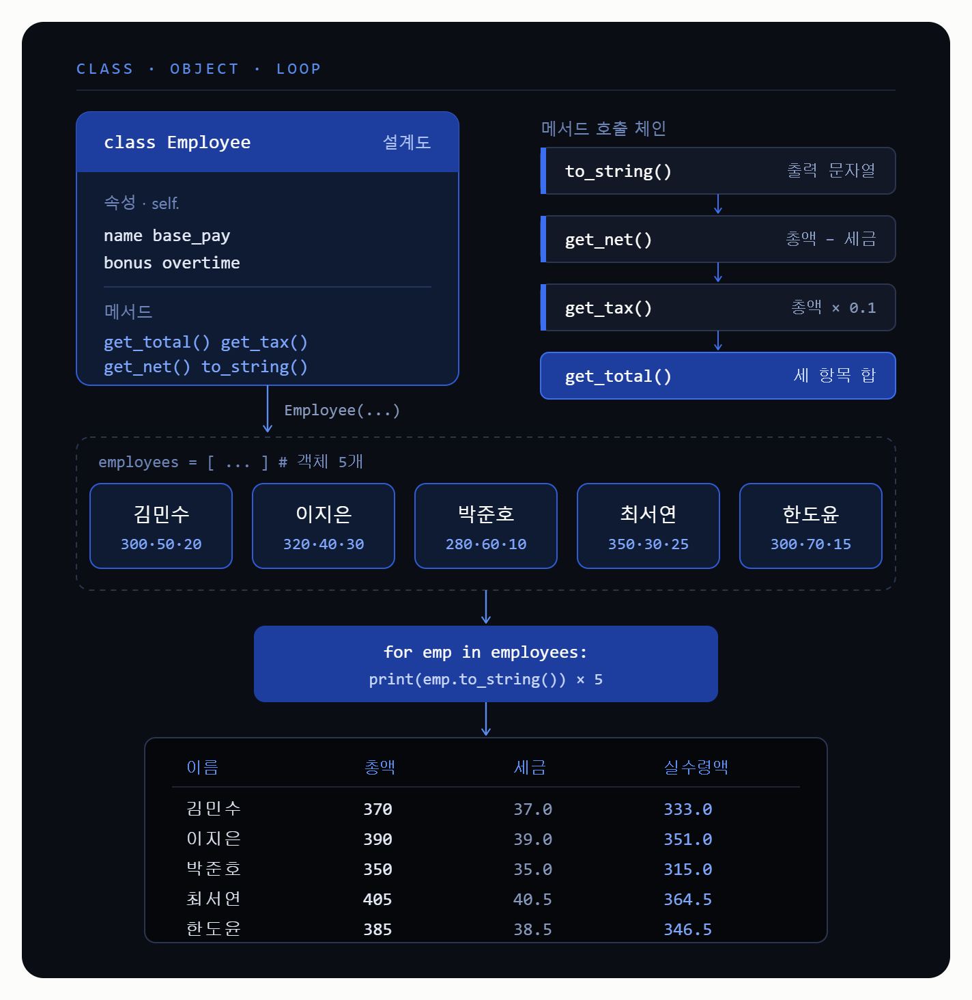
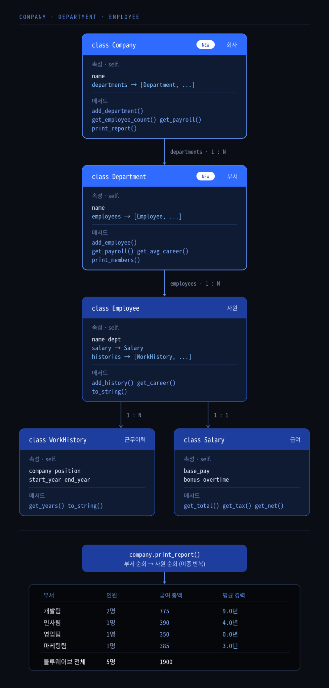

# Class_Method

Python 클래스와 객체, 생성자·소멸자, 접근 제어를 학습하고 객체 간 협력 구조까지 확장해 본 실습 기록입니다. Jupyter Notebook에서 개념과 문제를 익히고, Python 스크립트로 성적표와 회사 관리 예제를 단계적으로 구현했습니다.

## 무엇을 배웠나요?

| 학습 주제 | 학습 내용 | 실습 방식 |
| --- | --- | --- |
| 클래스와 객체 | 클래스와 인스턴스의 차이, 속성, 인스턴스 메서드, `self` | `Dog`, `Student`, `BankAccount`, `ChatBot`을 만들고 객체별 상태 확인 |
| 초기화와 객체 수명 | `__init__`, 기본값·키워드 인자, `__del__`, 참조 관계 | 생성·재할당·참조 삭제 시 메시지를 관찰하고 연결 객체 구현 |
| 접근 제어와 캡슐화 | public, `_name` 관례, `__name` 이름 맹글링, getter/setter, `@property` | 잔액·점수·대화 기록을 다루는 예제와 빈칸 문제로 학습 |
| 상태 관리와 자원 정리 | 클래스 변수와 인스턴스 변수, 가변 리스트 공유, 파일 닫기 | 챗봇 기록 분리, 접속자 수 집계, `FileLogger`와 `with` 문 구현 |
| 객체 간 협력 | 객체를 속성으로 보유하는 has-a 관계, 객체 리스트, 책임 분리 | `Employee` → `Department` → `Company` 구조로 급여와 경력 집계 |

`_name`은 접근을 강제로 막는 기능이 아니라 내부용이라는 관례입니다. `__name` 역시 보안 장치가 아니라 이름 충돌과 실수 방지를 위한 이름 맹글링입니다. `del`은 참조를 제거하며, `__del__`의 실행 시점은 항상 보장되지 않으므로 파일 같은 자원은 `close()`나 `with`로 명시적으로 정리하는 것이 핵심입니다.

## 어떻게 실습했나요?

### 1. 개념을 읽고 직접 객체 만들기

[클래스·객체 실습](1_class_object_실습.ipynb)에서 빈칸을 채우고 메서드를 호출하면서 `self`와 객체별 속성 변화를 확인했습니다. 학생의 합격 여부, 계좌 입출금, 챗봇 대화 기록처럼 작은 기능을 클래스로 묶었습니다.

### 2. 생성과 정리 과정 관찰하기

[생성자·소멸자 실습](2_생성자소멸자_실습.ipynb)에서 초기값 설정, 음수 입력 보정, 객체 재할당과 참조 삭제를 다뤘습니다. 정삼각형 `Figure`, 모의 `ApiClient`, 챗봇 예제로 객체 수명과 상태를 연습했습니다. API 예제는 실제 외부 서비스 호출이 아닌 학습용 모의 구현입니다.

### 3. 접근 제어와 복습 문제 풀기

[접근 제어 실습](3_접근제어_실습.ipynb)은 public/protected/private 표기, 상속 맛보기, 이름 맹글링, getter/setter와 `@property`를 다룹니다. 일부 셀은 빈칸·골격 상태로 남아 있습니다.

| 복습 파일 | 문제 구성 | 확인 방법 |
| --- | --- | --- |
| [클래스·객체 복습](class_object_복습테스트.ipynb) | `Product`, `PointCard`, `TodoList`, 챗봇 기록 분리, `Account`와 `Bank` | 반환값과 상태를 `assert`로 확인하는 채점 셀 |
| [생성자·소멸자 복습](생성자소멸자_복습학습지.ipynb) | `Rectangle`, `DBConnection`, `GameCharacter`, `Session`, `FileLogger` | 출력 캡처, 상태 검사, 파일 내용 검사, `with` 정리 확인 |

### 4. 딕셔너리 코드를 객체 지향 구조로 확장하기

`object_practice`의 파일은 번호 순서로 비교하면 데이터와 기능을 묶어 가는 과정을 볼 수 있습니다.

| 파일 | 구현 내용 | 학습 포인트 |
| --- | --- | --- |
| [object_ex01.py](object_practice/object_ex01.py) | 학생 딕셔너리 목록으로 총점·평균 출력 | 데이터 구조와 반복 처리 |
| [object_ex02.py](object_practice/object_ex02.py) | `create_student()`로 학생 데이터 생성 | 반복되는 생성 작업을 함수로 분리 |
| [object_ex03.py](object_practice/object_ex03.py) | 총점·평균·출력 함수를 분리 | 기능별 책임 분리 |
| [object_ex04.py](object_practice/object_ex04.py) | `Student`에 성적과 계산 메서드 결합 | 데이터와 동작을 하나의 객체로 묶기 |
| [object_ex05.py](object_practice/object_ex05.py) | `Employee`의 총급여·세금·실수령액 계산 | 클래스를 다른 문제에 적용하기 |
| [object_ex06.py](object_practice/object_ex06.py) | 사원이 `Salary` 객체 보유 | 객체 합성과 급여 계산 책임 분리 |
| [object_ex07.py](object_practice/object_ex07.py) | `WorkHistory` 목록과 총 경력 계산 | 일대다 관계와 객체 리스트 순회 |
| [object_ex08.py](object_practice/object_ex08.py) | `Department`, `Company`로 확장 | 부서별·회사 전체 집계, 빈 부서 처리 |

급여 예제의 세금 10%는 계산 연습을 위한 가정입니다. 경력은 각 이력의 종료 연도와 시작 연도의 차이를 더하며, 중복 기간은 별도로 처리하지 않습니다.

## 설계도를 따라 진행한 코딩 실습

**아래 설계도 4장을 참고하여 클래스의 속성·메서드·객체 관계를 코드로 옮기는 방식으로 실습했습니다.** `object_ex05.py`부터 `object_ex08.py`까지 단일 사원 클래스 → 급여 객체 분리 → 근무 이력 추가 → 부서·회사 집계 순서로 확장했습니다. 이미지는 학습에 사용한 설계 자료이며, 아래 설명은 현재 저장된 코드와 비교한 내용입니다.

### 1단계 — Employee 하나로 급여 계산하기



대응 파일: [object_ex05.py](object_practice/object_ex05.py)

설계도의 `name`, `base_pay`, `bonus`, `overtime`을 생성자에서 저장하고, `get_total()`로 세 급여 항목을 합산하도록 구현했습니다. `get_tax()`는 총액의 10%, `get_net()`은 총액에서 세금을 뺀 값을 반환합니다. `to_string()`에서 각 계산 메서드를 호출해 출력 문자열을 만들고, 사원 객체 5개를 리스트에 넣어 `for` 문으로 출력했습니다.

그림의 호출 체인은 계산 간 의존성을 요약합니다. 실제 코드의 `to_string()`은 `get_total()`, `get_tax()`, `get_net()`을 각각 호출하며, `get_net()`은 다시 `get_total()`과 `get_tax()`를 호출합니다.

현재 코드에서는 `bonus`를 `bouns`로 표기하고, 샘플 이름 5개를 모두 `김민수`로 사용합니다. 설계도와 이름은 다르지만 급여 입력값과 계산 구조는 대응합니다.

### 2단계 — Employee가 Salary 객체를 갖도록 분리하기


대응 파일: [object_ex06.py](object_practice/object_ex06.py)

급여 속성과 계산 메서드를 `Salary`로 옮기고, `Employee`에는 `name`, `dept`, `salary`를 두었습니다. 설계도의 has-a 화살표를 `self.salary = salary`로 구현한 것입니다. `Employee(..., Salary(...))` 형태로 객체를 조합하고, `Employee.to_string()`에서 `self.salary.get_total()` 등의 메서드를 호출합니다.

사원 객체 5개를 순회해 이름·부서·총액·세금·실수령액을 출력합니다. 급여 값은 설계도와 같으며, 샘플 부서 배정은 실제 코드에서 다르게 지정했습니다. 이 단계에서는 상속이 아닌 **객체를 속성으로 보유하는 합성**을 연습했습니다.

### 3단계 — WorkHistory 목록으로 일대다 관계 구현하기


대응 파일: [object_ex07.py](object_practice/object_ex07.py)

설계도의 `histories → [WorkHistory, ...]`를 인스턴스별 빈 리스트로 만들고, `add_history()`에서 이력 객체를 추가했습니다. `WorkHistory.get_years()`는 종료 연도에서 시작 연도를 뺍니다. `Employee.get_career()`는 이력 목록을 순회해 근무 연수를 합산합니다.

급여 객체 하나를 보유하는 관계와 여러 근무 이력을 보유하는 관계를 함께 구현했습니다. 최서연의 4년·4년·3년 이력을 더해 11년을 계산하고, 이력이 없는 사원은 0년 및 `이력 없음(신입)`으로 출력합니다. 사원별 출력에 이어 각 사원의 이력을 순회하는 중첩 반복도 실습했습니다.

설계도는 사원 5명을 예시로 들지만 실제 코드는 3명이며, 경력은 순서대로 7년·0년·11년입니다. `Salary` 내부의 기본급 속성 이름은 설계도의 `base_pay`와 달리 `base_py`로 작성되어 있습니다.

### 4단계 — Department와 Company로 집계 범위 확장하기



대응 파일: [object_ex08.py](object_practice/object_ex08.py)

`Department.employees`에 사원 객체를, `Company.departments`에 부서 객체를 저장하도록 구현했습니다. `add_employee()`와 `add_department()`로 관계를 구성한 뒤, 부서는 사원을 순회해 급여 총액과 평균 경력을 계산하고 회사는 부서를 순회해 전체 인원과 급여를 합산합니다. `Company.print_report()`는 이 메서드들을 호출해 부서별 보고서를 출력합니다.

설계도의 회사 → 부서 → 사원 구조를 따라 집계 책임을 나눴으며, 사원이 없는 마케팅팀도 추가해 평균 경력 계산 시 0으로 나누지 않도록 처리했습니다.

| 비교 항목 | 설계도 | 현재 코드 |
| --- | --- | --- |
| 전체 인원 / 급여 총액 | 5명 / 1900 | 3명 / 1145 |
| 부서별 인원 | 개발 2명, 나머지 각 1명 | 개발·인사·영업 각 1명, 마케팅 0명 |
| 평균 경력 | 개발 9년, 인사 4년, 영업 0년, 마케팅 3년 | 개발 7년, 인사 0년, 영업 11년, 마케팅 0년 |
| `Department.print_members()` | 설계에 포함 | 미구현 |
| `WorkHistory.to_string()` | 설계에 포함 | 07번에는 구현, 08번에는 없음 |

설계도의 모든 항목과 예시 데이터를 동일하게 복제한 것은 아닙니다. **설계도의 핵심 객체 관계와 계산 흐름을 따라 코딩하면서 샘플 데이터를 바꾸고, 빈 부서 처리까지 실습한 기록**입니다.

## 실행 방법

### Python 스크립트

Python 3 환경에서 저장소 루트 기준으로 실행합니다. 스크립트는 외부 패키지 없이 실행할 수 있습니다.

```powershell
python object_practice/object_ex01.py
python object_practice/object_ex08.py
```

마지막 예제는 개발팀·인사팀·영업팀·빈 마케팅팀을 집계합니다. 샘플 데이터 기준 전체 인원은 **3명**, 급여 총액은 **1145**이며 빈 부서의 평균 경력은 **0.0년**입니다.

### Jupyter Notebook

1. 가상환경을 만듭니다: `python -m venv .venv`
2. 실행 도구를 설치합니다: `.venv\Scripts\python -m pip install jupyterlab ipykernel`
3. Jupyter를 시작합니다: `.venv\Scripts\python -m jupyterlab`
4. 원하는 노트북을 열고 위에서부터 셀을 실행하며 문제를 풉니다.

VS Code의 Python·Jupyter 확장으로도 노트북을 열 수 있습니다. 이 경우 커널을 해당 가상환경으로 선택합니다.

## 실습 기록을 읽을 때

이 저장소는 학습 중 작성한 코드와 문제를 보존한 기록이며, 모든 노트북이 완성된 정답이나 전체 실행을 보장하는 형태는 아닙니다. 같은 클래스 이름을 여러 셀에서 재정의하므로 실행 순서에 따라 상태가 달라질 수 있습니다.

| 위치 | 현재 확인된 내용 | 복습할 때 확인할 점 |
| --- | --- | --- |
| `1_class_object_실습.ipynb`의 `ChatBot` | 기본 인자가 `history=[]`여서 객체 간 리스트 공유 가능 | `__init__` 내부에서 `self.history = []`로 각 객체의 기록 생성 |
| `1_class_object_실습.ipynb`의 초기화 예제 | 전달받은 값 대신 고정값 저장, 다른 객체를 출력하는 부분 존재 | 인자를 속성에 저장하고 방금 만든 객체를 출력하는지 확인 |
| `3_접근제어_실습.ipynb` | 미완성 셀과 `FileLogger` 정의 없이 포함된 채점 셀 존재 | 해당 클래스 구현과 채점 대상의 연결을 확인한 뒤 실행 |

가상환경, Python 캐시, 노트북 체크포인트, 실행 로그, 로컬 편집기 설정과 `.env` 파일은 Git 추적에서 제외합니다.
